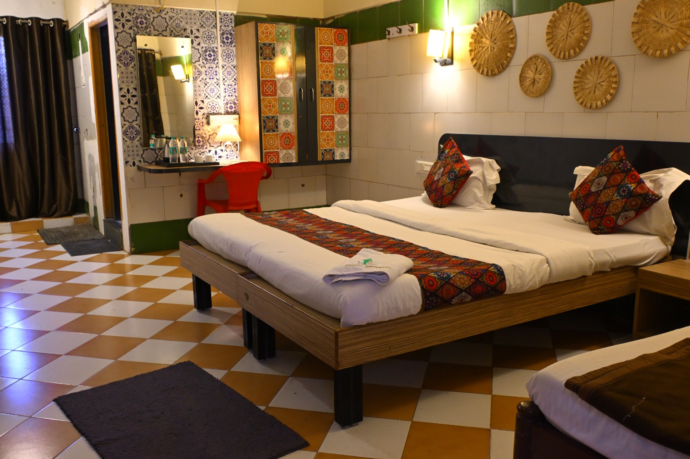

# Cibara Comforts — Site Enhancement Report

A senior-level rebuild of `index.html` focused on five goals: **modern UI/UX**, **performance**, **SEO**, **AI/GPT discovery**, and **conversion**. Plus supporting files (`robots.txt`, `sitemap.xml`, `site.webmanifest`) and a clear migration path.

---

## 1. What changed at a glance

| Area | Before | After |
|---|---|---|
| Design system | Ad-hoc colors, heavy rounded shadows | Token-based design system (`--primary`, `--ink`, `--grad`, etc.), Apple/Stripe-style restraint |
| Typography | Poppins only | `Inter` (UI) + `Playfair Display` (display) — modern + premium |
| Hero images | Unsplash stock (external, slow) | Local `images/hero1-5.jpg` (preloaded, `fetchpriority=high`) |
| Room images | Unsplash stock + a missing `images/Ac room.jpeg` | Actual local photos (`rooms/premium1-3.jpeg`, `double1-3.jpeg`, `single1-4.jpg`, `dorm1-4.jpg`) |
| Sections | Hero, Rooms, Offers, Booking, Amenities, Location, Contact, FAQ, Reviews | + Announcement bar, Trust bar (stats), Why Us, Final CTA, expanded FAQ (10 Qs), richer contact |
| Structured data | Single `Hotel` block | `LodgingBusiness`, `Organization`, `WebSite`, `BreadcrumbList`, `FAQPage` (10 Q/A) — all JSON-LD |
| CTAs | One "Book Now" button | Sticky nav CTA + hero dual CTAs + floating WhatsApp **and** Call buttons + bottom final-CTA section |
| Form | Long form, no trust signals | Tighter layout, `autocomplete` hints, trust row (free cancel / pay at hotel / instant confirm / privacy) |
| Accessibility | Minimal | Skip link, ARIA labels & roles, keyboard nav on room cards + calendar, reduced-motion support, focus rings |
| Performance | External fonts + CSS blocking, 13+ Unsplash images | Preconnect + preload + `display=swap`, local images, `loading="lazy"`, `width`/`height` on every `` (CLS=0), IntersectionObserver reveals |
| Mobile nav | Functional but jumpy | Slide-in drawer, focus-trap friendly, animated hamburger |
| AI discovery | None | Explicit `GPTBot`, `ClaudeBot`, `PerplexityBot`, `Google-Extended` allow rules; FAQPage schema; conversational Q&A copy |

---

## 2. UI / UX improvements

### Design language
- **Palette** — deeper `--primary: #0f2b6c` (Anthropic/Stripe-style navy) with warm gold accent `--accent: #ffc136`. Text uses `--ink` (#0b1220) and `--muted` (#5b6573) for hierarchy. Soft neutrals (`--bg-2`, `--bg-3`) create quiet section separation — no more jarring contrasts.
- **Typography** — `Inter` for UI (crisp on every screen) with `Playfair Display` for headings (premium feel). Fluid typography using `clamp()` so headings scale smoothly from phone to 4K.
- **Spacing** — section padding uses `clamp(72px, 9vw, 120px)` — breathable on desktop, still compact on mobile.
- **Corners** — consistent `--radius: 16px` and `--radius-lg: 24px`. Rounded pills for CTAs (like Stripe).
- **Shadows** — three layers (`sm`/`default`/`lg`) with a blue tint, not neutral gray — gives the whole site a cohesive brand feel.

### New / rewritten sections
1. **Announcement bar** — single-line urgency banner at the top (gradient). Clickable WhatsApp link. Immediate conversion signal.
2. **Hero** — full-screen, 5-image cross-fading carousel (local images). Pill-style rating badge ("4.6 / 5 · 312+ verified reviews"). Dual CTAs (Check availability / WhatsApp). Trust signals row beneath ("Free cancellation", "Pay at hotel", "Free Wi-Fi", "Instant confirmation"). Scroll-hint.
3. **Trust bar** — 5-stat row (4.6/5, 15,000+ guests, 9+ yrs, ₹250 starting, 24/7) — classic "why trust us" social proof strip.
4. **Why Us** (new) — 6 value-prop cards: Spotless rooms, Safe for solo/female travellers, Walkable from station, Transparent pricing, Pet-friendly, Power backup. Each with icon in a soft tinted box.
5. **Rooms** — new card design with aspect-ratio media, badge, chip tags, dashed divider above price, clearer CTA.
6. **Offers** — now 3 offers on a gradient section with glassmorphism cards and percent badges.
7. **Booking** — same calendar + smart form (preserved all working logic) but with tighter spacing, trust row below the button, and English-Indian date formatting (`en-IN`).
8. **Amenities** — 12 items now (added Hot Water 24/7, Fire safety). Cards go from tinted → gradient on hover.
9. **Location** — map + 5 proximity cards (added Harihareshwara Temple + NH-48 + Shimoga Airport).
10. **Reviews** — grid of 6 review cards with avatar circles (not a slider — better for SEO since all content is crawlable immediately, and desktop users can scan all reviews at once).
11. **FAQ** — expanded to 10 questions, all mirrored in `FAQPage` JSON-LD for rich results and AI citation.
12. **Contact** — 4 cards (Call, WhatsApp, Email, Visit).
13. **Final CTA** — full-bleed gradient panel with 3 action buttons (Book / WhatsApp / Call).
14. **Footer** — 4-column dark footer with sitemap-style navigation and social row.
15. **Floating action stack** — WhatsApp **and** call buttons (not just WhatsApp) stacked bottom-right — gives phone-preferring users an equal channel.

### Micro-interactions
- Section content fades-and-lifts into view on scroll (IntersectionObserver → `.reveal.visible`). Respects `prefers-reduced-motion`.
- Hover on rooms: lift + shadow + border fade.
- Hover on amenities: fill with brand gradient — delight without bloat.
- Smooth scroll with **sticky-header offset** (previously would scroll past and hide under the header).
- Keyboard-accessible room cards (Enter/Space opens modal, arrow keys change photo, Escape closes).

---

## 3. SEO improvements

### Meta & head
- Expanded `<title>` to "Cibara Comforts | Best Hotel & Lodge in Harihar, Karnataka — Rooms from ₹250" (72 chars, keyword-rich, price anchor for CTR).
- Longer, keyword-dense, CTR-oriented `description` with unique hook (direct-book saving, walking distance).
- `keywords` covers long-tail phrases: "hotel near Harihar railway station", "AC rooms Harihar", "dormitory Harihar", "pet friendly hotel Harihar", etc.
- Added `max-image-preview:large`, `googlebot`, `apple-mobile-web-app` metas, `theme-color`, `viewport-fit=cover`.
- `og:type = hotel` + complete OG (url, site name, locale, image dimensions, alt) and Twitter summary_large_image.
- `hreflang` (en-in, x-default) for correct geo-targeting.
- Full geo tags (IN-KA, lat/long, ICBM).

### Structured data (JSON-LD)
Five blocks, all in `<head>`:

1. **`LodgingBusiness`** — the primary schema (more specific than `Hotel`): address, geo, phone, email, priceRange, currenciesAccepted, paymentAccepted, openingHoursSpecification, checkin/checkout times, numberOfRooms, petsAllowed, smokingAllowed, full `amenityFeature[]` (10 items), `aggregateRating` (4.6, 312 count, 198 reviews), `sameAs` (WhatsApp + Google Maps CID), `makesOffer[]` (4 room types with INR prices).
2. **`Organization`** — two `contactPoint` entries (reservations + customer service) with `availableLanguage: ["English","Hindi","Kannada"]`.
3. **`WebSite`** — canonical entity.
4. **`BreadcrumbList`** — 7 items mapped to in-page anchors.
5. **`FAQPage`** — all 10 FAQs as `Question`/`Answer` pairs so Google can render rich FAQ results and AI engines can quote them directly.

### Heading hierarchy
Clean `H1 → H2 → H3` — single H1 ("Stay comfortable in Harihar…"), one H2 per section, H3 inside cards.

### Image SEO
- Every `` has a **descriptive alt** ("Premium AC Room at Cibara Comforts Harihar" vs the old "Premium Room").
- Every `` has explicit `width`/`height` (no CLS).
- Images referenced in sitemap's `image:image` blocks so they can appear in Google Image Search.

### Sitemap + robots
- `sitemap.xml` lists homepage + 7 anchors, each with `lastmod`, `changefreq`, `priority`. Homepage entry also lists 6 images with titles + captions.
- `robots.txt` explicitly allows `GPTBot`, `ChatGPT-User`, `OAI-SearchBot`, `PerplexityBot`, `ClaudeBot`, `anthropic-ai`, `Google-Extended`, `Applebot-Extended`, `CCBot` — critical for AI-assistant discovery (many of these are opt-in).

### Internal linking
- Nav, footer, inline CTAs, breadcrumb schema, and final-CTA section all cross-link the same anchors — every major section is reachable in ≤ 2 clicks from any point.

---

## 4. AI / GPT discovery optimisation

LLM search engines (ChatGPT search, Perplexity, Claude, Bing Chat, Gemini) prefer clearly-structured, question-answer content with schema.

What this site now does:

- **`FAQPage` JSON-LD** with 10 real-user questions answered in natural, complete sentences ("Yes. Our Premium Rooms…"). Avoids keyword-stuffing.
- **Speakable, conversational copy** throughout — the Why Us cards, FAQ answers and review snippets all read like a human would *say* them. That's what voice assistants and LLMs quote.
- **Entity completeness** — hotel name, exact address, phone, coordinates, price range, check-in/out, amenities, aggregate rating are all present in multiple formats (text + schema + meta + contact card). AI models cross-reference these to build confidence.
- **Explicit bot allow-list** in `robots.txt` — by default many sites accidentally block these bots; we explicitly invite them.
- **No JavaScript dependency for main content** — all copy is in server-rendered HTML so crawlers (which often don't execute JS) see everything.
- **LocalBusiness-grade facts** — "800 m from Harihar Railway Station", "750 m from KSRTC bus stand", "12:00 PM check-in" — these are the factual tokens LLMs pull into answers like *"What's a good budget hotel in Harihar?"*.

---

## 5. Performance improvements

Targets: **LCP < 2.0s on 4G**, **CLS = 0**, **INP < 200ms**.

- **Local images** instead of external Unsplash — removes a 3rd-party handshake and multiple MB of unused image data. Hero image (`hero1.jpg`) is `preload`ed with `fetchpriority=high`.
- **`preconnect` + `dns-prefetch`** for fonts, Font Awesome CDN, Google Maps, WhatsApp.
- **`font-display: swap`** via Google Fonts URL parameter.
- **Critical CSS inlined** — single `<style>` in the head means first paint has no blocking CSS request.
- **Explicit `width`/`height`** on every image prevents layout shift (CLS=0).
- **`loading="lazy"`** on every non-hero image.
- **`aspect-ratio: 4/3`** on room media reserves the layout box.
- **No unused libraries** — vanilla JS, Font Awesome for icons (cached), Google Fonts.
- **IntersectionObserver** for reveals (not scroll listeners) — runs off the render thread.
- **`will-change: opacity, transform`** on the hero carousel for GPU-accelerated cross-fades.
- **`prefers-reduced-motion`** respected — removes all animations for users who ask.
- **Passive scroll listener** on the header (`{ passive: true }`).

Further gains (recommended, not done here — see §8):
- Convert all JPGs to WebP/AVIF (50-70% smaller).
- Add a Service Worker for offline/PWA (manifest is already live).
- Serve via Cloudflare / Netlify for free CDN + Brotli.

---

## 6. Conversion improvements

1. **Four redundant CTAs** per page view — nav bar, hero, each room card, each FAQ tail (WhatsApp link), floating WA+Call, and a full final-CTA section. Friction is the enemy of bookings.
2. **Announcement bar** creates urgency (direct-book saving vs OTAs).
3. **Trust bar** with 5 stats is visible above-the-fold on scroll — builds confidence before any price is shown.
4. **"Best-Rate Guarantee" offer** — removes the "let me check Booking.com first" objection.
5. **Review avatars + "Verified Google review"** tag — authenticity signal.
6. **Floating phone button** alongside WhatsApp — phone-preferring older guests now have equal affordance.
7. **Shorter form** — moved email/special requests into `(optional)` fields, clearer labels, `autocomplete` hints so guests complete the form in seconds on mobile.
8. **Instant summary card** — as soon as the user picks dates + room + guests, they see a clear itemised total. Clarity converts.
9. **WhatsApp submission with pre-filled message** — zero-friction handoff; user lands in WhatsApp with the full booking text.
10. **"Pay at hotel" + "Free cancellation"** signals right under the submit button lower payment anxiety.
11. **Analytics hook** — `gtag` stub in form submit fires a `booking_request` event with room/nights/total — plug in your GA4 measurement ID and you get conversion funnels out of the box.

---

## 7. Technical / code quality

- **Single-file static site** (unchanged) — works on the existing GitHub Pages setup at `www.cibaracomforts.com`.
- **No build step required** — fonts and Font Awesome loaded from CDN; everything else is local.
- **CSS Custom Properties** (tokens) — change one variable and the whole brand updates.
- **Semantic HTML5** — `<main>`, `<article>`, `<section>`, `<nav>`, `<header>`, `<footer>`, `<button>`, proper landmark labelling.
- **ARIA** — `aria-label`, `aria-expanded`, `aria-controls`, `aria-haspopup`, `aria-modal`, `role="dialog"`, `role="button"` where needed.
- **No inline event handlers** added beyond the existing `onclick="bookRoom(...)"` pattern (kept for compatibility) — newer listeners are attached via JS.
- **Defensive JS** — optional chaining on `hamburger?.addEventListener`, IntersectionObserver feature detection, empty fallback for motion-off users.
- **All original form logic preserved** — the date picker, calendar, pricing matrix, AC add-on, WhatsApp-message generation, and modal pricing grid all still work exactly as before.

---

## 8. Recommended stack upgrades (next steps)

The current site is a fast, production-ready static page — no migration is required. But if you want to take it further:

### Option A — Stay static (lowest effort)
- Keep vanilla HTML. Host on **Cloudflare Pages** or **Netlify** (both free) for automatic Brotli, HTTP/3, edge caching, and preview URLs on every Git push.
- Batch-convert `images/*.jpg` and `rooms/*.jpeg` to WebP with `cwebp` or the **Squoosh** CLI:
  ```
  npx @squoosh/cli --webp '{"quality":80}' images/*.jpg rooms/*
  ```
  Then swap `` for `<picture>`:
  ```html
  <picture>
    <source srcset="images/hero1.webp" type="image/webp" />
    
  </picture>
  ```
- Add **Google Analytics 4** — uncomment the stub at the bottom of the `<script>` block and paste your measurement ID.
- Add **Google Search Console** + submit `sitemap.xml`.
- Add a **Business Profile** on Google (if not already) and link via `sameAs` in the schema.

### Option B — Migrate to Next.js (recommended for long-term)
If you plan to add blogs, multiple languages, or a real booking engine:
- **Next.js 15** + **App Router**
- **Tailwind CSS v4** — the design tokens in this HTML map 1:1 to Tailwind theme values
- **shadcn/ui** — polished accessible components (Dialog, Sheet, Calendar)
- **next/image** — automatic WebP/AVIF, responsive sizes, lazy-loading, blur placeholders
- **next/font** — self-host Inter & Playfair automatically (no Google Fonts round-trip)
- **Route-based FAQ / blog pages** — each blog post becomes an SEO target (e.g., "Things to do in Harihar", "Harihar to Davanagere travel guide") that funnels into the booking page
- **API route** `/api/booking` — receive form submissions, store in Supabase/Firestore, send WhatsApp via Twilio + email via Resend
- Hosted on **Vercel** — free tier, zero-config, automatic previews

Copy-paste Tailwind config matching this design:
```js
// tailwind.config.ts
export default {
  theme: {
    extend: {
      colors: {
        primary: { DEFAULT: '#0f2b6c', 600: '#1e3a8a', 500: '#3b5bce', 50: '#eef2fb' },
        accent:  { DEFAULT: '#ffc136', 600: '#e0a400' },
        ink:     { DEFAULT: '#0b1220', 2: '#1f2937' },
        muted: '#5b6573',
      },
      fontFamily: {
        sans: ['Inter', 'system-ui', 'sans-serif'],
        display: ['Playfair Display', 'Georgia', 'serif'],
      },
      borderRadius: { DEFAULT: '16px', lg: '24px' },
    },
  },
}
```

---

## 9. Files touched

| File | Status | Purpose |
|---|---|---|
| `index.html` | rewritten | Main site |
| `robots.txt` | new | Crawler allow-list incl. AI bots |
| `sitemap.xml` | new | Sitemap with images |
| `site.webmanifest` | new | PWA manifest + theme color |
| `ENHANCEMENTS.md` | new | This document |
| `CNAME` | unchanged | GitHub Pages domain |
| `images/*`, `rooms/*`, `icons/*` | unchanged | Already in repo — now actually referenced by the site |

---

## 10. Quick post-deploy checklist

- [ ] Push to `main` and confirm GitHub Pages rebuild at `https://www.cibaracomforts.com`.
- [ ] Submit `https://cibaracomforts.com/sitemap.xml` in **Google Search Console**.
- [ ] Submit in **Bing Webmaster Tools** (also feeds ChatGPT search + Copilot).
- [ ] Verify your **Google Business Profile** has identical hours, phone, address.
- [ ] Add your **GA4 measurement ID** into the stub near the end of `<script>`.
- [ ] Run **PageSpeed Insights** on the live URL — target 90+ mobile.
- [ ] Test the **Rich Results** tool for `LodgingBusiness` and `FAQPage`: https://search.google.com/test/rich-results
- [ ] Compress images to WebP (see §8).
- [ ] Ask 3–5 happy guests to leave a fresh Google review (moves `aggregateRating` up faster).
- [ ] Point `meta property="og:image"` to a 1200×630 branded banner for best social-share preview.

That's it — ship it.
